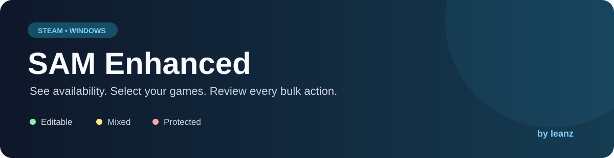
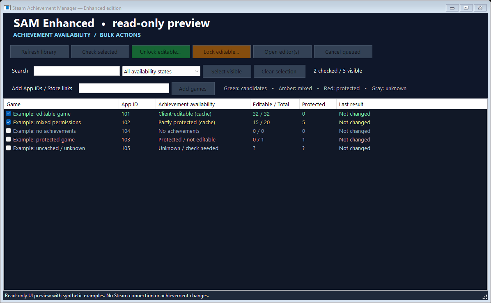

<p align="center"></p>

<p align="center">
  
  
  
  <a href="https://discord.gg/JaRSAWTUMx"></a>
</p>

# SAM Enhanced

**[Quick start](#quick-start) · [Availability](#availability) · [Build](#build-from-source) · [Credits](#credits-and-license)**

<p align="center"><strong>Achievement availability at a glance. One reviewed action across multiple games.</strong><br>Credits: <strong>leanz</strong> · <a href="https://discord.gg/JaRSAWTUMx">Discord community</a></p>

Version **7.0.41.1**. An independently modified edition of [Steam Achievement Manager](https://github.com/gibbed/SteamAchievementManager), based on the supplied 7.0.41 source archive. Original software by Rick / gibbed; enhanced edition prepared for **leanz**. Community: https://discord.gg/JaRSAWTUMx



### What you get

| Feature | How it works |
| --- | --- |
| **Availability at a glance** | Colored labels distinguish editable, mixed, protected and unknown states. |
| **One action, multiple games** | Unlock or relock editable achievements across checked games. |
| **Review before applying** | Read-only inspection produces the exact plan for confirmation. |
| **Protected entries skipped** | Parent permissions and trusted-server flags are respected. |
| **Per-game results** | Rejected entries and unconfirmed saves are reported separately. |
| **Manual control** | Add App IDs or Store links; open separate original editors. |

### Quick start

Download **SAMEnhanced-v7.0.41.1-windows-x86.zip** from this repository’s **Releases** section. GitHub’s automatic source-code ZIP contains source, not the runnable app.

1. Extract the entire Windows ZIP into one folder. Keep both executables and all DLLs together.
2. Open Steam and sign in.
3. Run **Start.cmd** or **SAM.Picker.exe**. Requires Windows and .NET Framework 4.8. The app is built for x86, including on 64-bit Windows.
4. Check the games you want, then choose **Check selected**, **Unlock editable…**, or **Lock editable…**.
5. Unlock/lock first reads each game, then shows a review of the proposed changes. Confirming applies that plan.

The bulk actions unlock or relock **all editable achievements** in the selected games that need that change. For individual achievements, choose **Open editor(s)**. Multiple selected games can have separate editors; close those editors before applying a bulk action to the same games.

### Availability

| State | Meaning |
| --- | --- |
| Green — Client-editable | Cached permissions or a live read show editable candidates. Steam can still reject a save. |
| Amber — Partly protected | Some entries are protected or unreadable. Only readable, unprotected entries are eligible. |
| Red — Protected / not editable | All schema entries are protected; the bulk action skips them. |
| No achievements | No achievement entries are reported. |
| Unknown / unavailable | Missing cache, failed read, or timeout. This does **not** mean the game is protected. Retry **Check selected**. |

The initial list uses local Steam metadata and cached achievement schemas, without changing achievements. A fresh stats read occurs before every bulk preview and again before applying the approved IDs. Local metadata may not include every owned game; use the App ID / Store link field for missing titles. A usable Steam license is required. This edition does not bypass ownership or server restrictions.

### Bulk behavior

- Up to two isolated game workers operate simultaneously; additional games are queued.
- The game and Steam account must still match the reviewed plan.
- Parent/container permission flags and trusted-server flags are respected.
- Already matching entries are skipped. One rejected game/entry does not stop other games.
- Statistics are not reset or changed by the bulk actions.
- A successful save requires Steam's asynchronous save response and a matching readback.
- The **Last result** column reports each game's outcome. An unconfirmed save may still be retried by Steam; do not assume no changes happened.
- **Cancel queued** stops pending games. Active saves finish; read-only checks can be stopped. Closing during a batch waits for active work.

### Build from source

GitHub Actions also builds and tests on Windows, then attaches a runnable ZIP and checksums to the workflow run. It does not publish a release automatically.

Install a .NET SDK supporting this SDK-style net48 project, then run on Windows:

```powershell
.\Build.ps1
```

Use `./Build.ps1 -Package` to also create a release ZIP and checksum file.

The script builds both apps, runs synthetic regression tests, and copies a runnable bundle to `dist/windows-x86`. Dependencies are restored from NuGet. No Steam credentials or API key are required for the build or synthetic tests.

The tests cover protection inheritance, unknown schemas, account/game mismatch, approved-ID scope, unlock/lock, partial failures, unconfirmed saves, and XML request/result handling. They use a fake store and do not change real account achievements.

Optional UI preview with synthetic data:

```powershell
.\dist\windows-x86\SAM.Picker.exe --preview
```

An explicitly invoked developer `--live-probe` test reads stats from an owned sample game without invoking writes. Real bulk saves were not tested against an account during preparation.

### Publish on GitHub

See [the upload guide](docs/GITHUB-UPLOAD-DE.md) for the exact files and steps. Release text is ready in [RELEASE_NOTES.md](RELEASE_NOTES.md).

Upload this source folder's contents to your repository. Include the original `LICENSE.txt`, `README.UPSTREAM.md`, and `NOTICE.txt`. Put the Windows ZIP in **Releases**, rather than committing build outputs. Do not upload account data, Steam caches, logs, temporary requests, `bin`, or `obj`.

Suggested repository description: **Steam Achievement Manager enhanced with achievement availability indicators, reviewed bulk unlock/lock actions, and per-game results.**

### Credits and license

Original SAM: **Rick / gibbed**. This is an altered, unofficial edition, not the upstream release. Enhanced edition credits: **leanz** — https://discord.gg/JaRSAWTUMx

Distributed under the included zlib license. Original copyright and source notices are retained.
